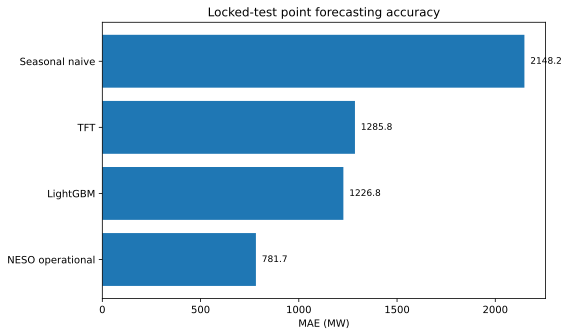
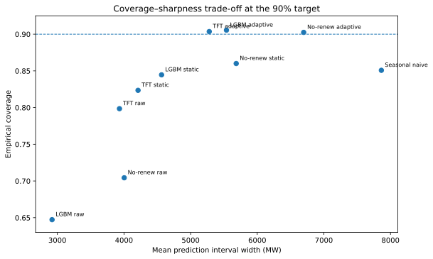
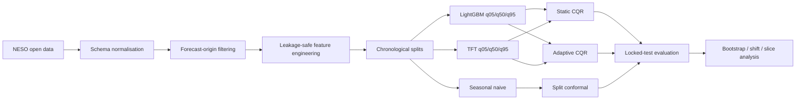
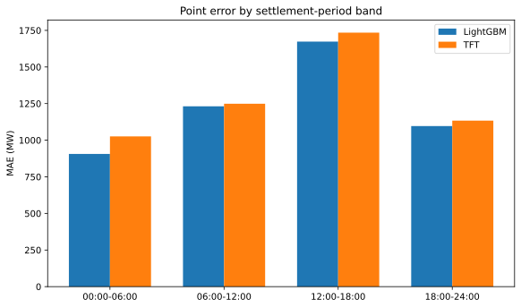
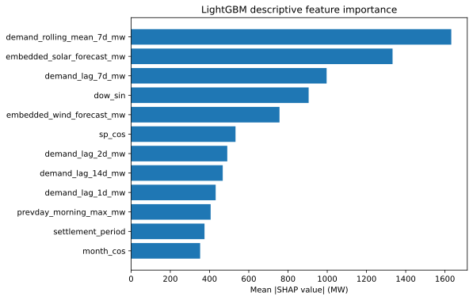

# Reliable Day-Ahead Electricity Demand Forecasting for Great Britain

[](https://github.com/vutakantiasha/GB-demand-conformal-forecasting/actions/workflows/ci.yml)
[](https://github.com/vutakantiasha/GB-demand-conformal-forecasting/actions/workflows/codeql.yml)


> A reproducible, leakage-aware research framework for **day-ahead Great Britain electricity-demand forecasting** using seasonal baselines, LightGBM quantile regression, a Temporal Fusion Transformer, and static/adaptive conformal prediction under temporal distribution shift.

## Highlights

- Fixed **12:15 Europe/London forecast origin on D-1** for every target day.
- Strict chronological **training → validation → calibration → locked test** protocol.
- Dynamic acquisition of official **NESO Open Data** with SHA-256 source manifests.
- Seasonal-naive, **LightGBM** and **Temporal Fusion Transformer (TFT)** forecasting models.
- Raw quantile intervals, **static CQR**, adaptive/prequential CQR and split conformal baselines.
- Point accuracy, calibration, sharpness, pinball loss, slice robustness and day-block bootstrap evaluation.
- Explicit temporal-shift diagnostics using standardised mean shift, KS statistics and Wasserstein distance.
- Reproducible outputs, tests, CI, security checks and a public results evidence pack.

## Locked research question

**How reliably can machine-learning models produce 90% day-ahead prediction intervals for Great Britain national electricity demand under temporal distribution shift, and to what extent do static and adaptive conformal calibration improve coverage without excessive loss of interval sharpness?**

## Key locked-test findings

| Model variant | MAE (MW) | RMSE (MW) | 90% coverage | Mean width (MW) | Interval score |
|---|---:|---:|---:|---:|---:|
| NESO operational reference | **781.7** | **1062.7** | — | — | — |
| LightGBM raw | 1226.8 | 1622.5 | 64.73% | 2920.4 | 9632.0 |
| LightGBM + static CQR | 1226.8 | 1622.5 | 84.46% | 4564.0 | 7045.7 |
| **LightGBM + adaptive CQR** | **1226.8** | **1622.5** | **90.55%** | 5537.9 | 6974.4 |
| TFT raw | 1285.8 | 1689.1 | 79.85% | 3932.1 | 7375.3 |
| TFT + static CQR | 1285.8 | 1689.1 | 82.35% | 4210.9 | 7076.0 |
| **TFT + adaptive CQR** | **1285.8** | **1689.1** | **90.36%** | **5279.7** | **6737.9** |
| Seasonal naive + split conformal | 2148.2 | 2974.2 | 85.08% | 7862.8 | 13091.6 |

**Interpretation.** LightGBM was the strongest research point forecaster, while adaptively calibrated TFT produced the best coverage–sharpness trade-off at the primary 90% target. NESO is retained as an **external operational reference**, not as a target the research prototype is expected to outperform.

<p align="center">
  
  
</p>

## Why the experiment is leakage-aware

The operational question is genuinely day-ahead: what could have been forecast at **12:15 on the previous day**? Features and renewable forecast snapshots are therefore constrained to information available at or before that origin.



### Chronological protocol

| Partition | Period | Purpose |
|---|---|---|
| Training | 2023-01-01 → 2024-12-31 | Fit candidate models |
| Validation | 2025-01-01 → 2025-04-30 | Hyperparameter/model selection only |
| Calibration | 2025-05-01 → 2025-12-31 | Conformal calibration only |
| **Locked test** | **2026-01-01 → 2026-08-31** | **Final evaluation only** |

The test period is not used for feature selection, model-family choice or hyperparameter tuning.

## Data sources

The pipeline discovers current NESO resources through the CKAN-compatible `datapackage_show` endpoint and records the exact resource identifier, download URL, retrieval timestamp, file size and SHA-256 checksum.

- [Historic Demand Data](https://www.neso.energy/data-portal/historic-demand-data)
- [Day Ahead Half Hourly Demand Forecast Performance](https://www.neso.energy/data-portal/day-ahead-half-hourly-demand-forecast-performance)
- [Embedded Wind and Solar Forecasts](https://www.neso.energy/data-portal/embedded-wind-and-solar-forecasts)

Raw datasets are **not redistributed** in this repository. Reproduction begins by downloading them from NESO and validating them against `data/raw/source_manifest.json` where applicable.

## Models

### Seasonal naive

A transparent benchmark using the same settlement period seven days earlier.

### LightGBM quantile regression

Independent q05, q50 and q95 models are trained after median-model hyperparameter selection on the validation period. The full feature set includes calendar structure, demand lags, rolling statistics and forecast-origin-safe embedded wind/solar forecasts.

### Temporal Fusion Transformer

The self-contained TFT implementation includes variable-selection networks, gated residual networks, LSTM encoder/decoder components, gated skip connections, temporal multi-head attention and direct multi-quantile output. The static-covariate pathway is intentionally omitted because the experiment contains a single aggregate GB time series rather than multiple entities with meaningful static identifiers.

## Conformal calibration

For raw lower/upper quantiles \([q_{0.05}, q_{0.95}]\), the CQR conformity score is:

```text
s_i = max(q05_i - y_i, y_i - q95_i)
```

The project evaluates:

- static CQR on the independent calibration partition;
- adaptive/prequential CQR with settlement-period-specific state;
- split-conformal residual intervals for the seasonal-naive baseline;
- 80%, 90% and 95% coverage sensitivity across adaptation rates and rolling windows.

A nominal 90% conformal interval is interpreted as **empirical marginal coverage**, not as a 90% conditional probability for an individual half-hour.

## Renewable-feature ablation

Removing embedded wind and solar forecasts increased LightGBM MAE from **1226.8 MW to 1486.4 MW**. At approximately 90% adaptive coverage, interval width increased from **5537.9 MW to 6697.0 MW**. The ablation therefore supports the predictive value of forecast-origin-safe renewable information for both point accuracy and interval efficiency.

## Temporal distribution shift

| Feature | Standardised mean shift | KS statistic | Wasserstein distance |
|---|---:|---:|---:|
| National demand | -0.121 | 0.079 | 806.4 |
| 7-day demand lag | -0.092 | 0.066 | 649.4 |
| Embedded wind forecast | 0.058 | 0.046 | 92.0 |
| **Embedded solar forecast** | **0.629** | **0.159** | **1373.1** |

Embedded solar exhibits the largest measured train-to-test shift. The repository reports this as a diagnostic association; it does **not** claim that the solar shift alone caused interval miscalibration.

## Repository structure

```text
.
├── README.md
├── RUN_ME_FIRST.md
├── CITATION.cff
├── LICENSE
├── SECURITY.md
├── configs/                     # Research and model configuration
├── src/gb_demand_forecasting/   # Reusable pipeline package
│   ├── data/                    # Acquisition, schema handling, preparation
│   ├── features/                # Leakage-safe feature matrices
│   ├── models/                  # Baseline, LightGBM, TFT
│   ├── conformal/               # Static/adaptive conformal methods
│   ├── evaluation/              # Metrics, bootstrap, shift, sensitivity
│   └── reporting/               # Figures and evidence-pack generation
├── tests/                       # Unit and integration tests
├── scripts/                     # Validation, security and run helpers
├── notebooks/                   # Thin analysis notebooks
├── app/                         # Streamlit results explorer
├── data/                        # Data instructions + source manifest only
├── artifacts/                   # Runtime artefact contract/documentation
├── results/                     # Locked metrics, diagnostics and figures
├── reports/                     # Data quality, training and reproducibility evidence
├── docs/                        # Research and engineering documentation
└── .github/workflows/           # CI, security and CodeQL workflows
```

## Quick start

Recommended: **Python 3.11 or 3.12**.

```bash
git clone https://github.com/vutakantiasha/GB-demand-conformal-forecasting.git
cd GB-demand-conformal-forecasting
python -m venv .venv
source .venv/bin/activate        # Windows: .venv\\Scripts\\activate
python -m pip install --upgrade pip
pip install -e ".[dev]"
```

Run the environment preflight and tests:

```bash
make doctor
make test
```

Validate live NESO metadata before a real run:

```bash
python scripts/validate_neso_metadata.py
```

Run the full research pipeline:

```bash
gbdf full-run --config configs/project.yaml
```

A deterministic synthetic engineering smoke run is also available:

```bash
gbdf full-run --config configs/smoke.yaml
```

Synthetic outputs validate the implementation only and are **not** research findings.

For the full run sequence, see [`RUN_ME_FIRST.md`](RUN_ME_FIRST.md).

## Evaluation outputs

The principal retained public evidence outputs are:

- `results/metrics/overall_metrics.csv`
- `results/metrics/slice_metrics.csv`
- `results/metrics/conformal_sensitivity.csv`
- `results/metrics/distribution_shift.csv`
- `results/metrics/lightgbm_shap_importance.csv`
- `results/bootstrap/mae_vs_seasonal_naive.csv`
- `results/error_analysis/top_error_days.csv`
- `reports/data_quality.json`
- `reports/training_summary.json`
- `reports/reproducibility_manifest.json`
- `reports/results_evidence_pack.md`

<p align="center">
  
  
</p>

## Reproducibility and provenance

- Source files are checksum-versioned in `data/raw/source_manifest.json`.
- Research settings are frozen in `configs/`.
- Runtime/package versions are recorded in `reports/reproducibility_manifest.json`.
- Data-quality checks are stored in `reports/data_quality.json`.
- Model-selection summaries are stored in `reports/training_summary.json`.
- A repository-wide SHA-256 inventory is stored in `PROJECT_MANIFEST_SHA256.txt`.
- The public repository uses **repository-relative paths** rather than machine-specific absolute paths.

See [`docs/REPRODUCIBILITY.md`](docs/REPRODUCIBILITY.md) and [`docs/RESEARCH_PROTOCOL.md`](docs/RESEARCH_PROTOCOL.md).

## Tests and security

```bash
make test
python scripts/security_audit.py
```

GitHub Actions provide automated CI and static/security checks. No secrets, raw credentials or private datasets are required by the repository.

## macOS Apple Silicon

The TFT stage is launched in an isolated Python subprocess to avoid native runtime collisions between LightGBM and PyTorch on Apple Silicon. See [`docs/MACOS_APPLE_SILICON.md`](docs/MACOS_APPLE_SILICON.md).

## Limitations

- Conformal coverage is marginal rather than guaranteed conditional coverage for every demand regime.
- Some high-demand slices remain under the nominal 90% target even when overall adaptive coverage is close to 90%.
- The research prototype uses a deliberately narrower information set than an operational system operator.
- Independently fitted quantile models can exhibit limited quantile crossing.
- DST transition days are excluded from the primary fixed-48-period benchmark and handled separately.

## Documentation map

| Document | Purpose |
|---|---|
| [`docs/ARCHITECTURE.md`](docs/ARCHITECTURE.md) | System components and data flow |
| [`docs/RESEARCH_PROTOCOL.md`](docs/RESEARCH_PROTOCOL.md) | Frozen experimental design |
| [`docs/DATA_CARD.md`](docs/DATA_CARD.md) | Data provenance, scope and limitations |
| [`docs/MODEL_CARD.md`](docs/MODEL_CARD.md) | Model intent, evaluation and limitations |
| [`docs/SOURCE_VERIFICATION.md`](docs/SOURCE_VERIFICATION.md) | NESO source decisions |
| [`docs/BACKEND_VALIDATION.md`](docs/BACKEND_VALIDATION.md) | Engineering and real-run validation record |
| [`docs/REPRODUCIBILITY.md`](docs/REPRODUCIBILITY.md) | Reproduction contract and evidence |
| [`docs/THREAT_MODEL.md`](docs/THREAT_MODEL.md) | Security assumptions and controls |
| [`docs/RUNBOOK.md`](docs/RUNBOOK.md) | Operational run procedure |

## Core methodological references

- Lim, B., Arık, S. Ö., Loeff, N., & Pfister, T. (2021). *Temporal Fusion Transformers for interpretable multi-horizon time series forecasting*. International Journal of Forecasting, 37(4), 1748–1764.
- Romano, Y., Patterson, E., & Candès, E. J. (2019). *Conformalized quantile regression*. Advances in Neural Information Processing Systems, 32.
- Gibbs, I., & Candès, E. J. (2021). *Adaptive conformal inference under distribution shift*. Advances in Neural Information Processing Systems, 34, 1660–1672.
- Barber, R. F., Candès, E. J., Ramdas, A., & Tibshirani, R. J. (2023). *Conformal prediction beyond exchangeability*. The Annals of Statistics, 51(2), 816–845.

## Citation

Machine-readable citation metadata are provided in [`CITATION.cff`](CITATION.cff).

## Licence

Code is released under the [MIT License](LICENSE). NESO datasets are not redistributed here and remain subject to the NESO Open Data Licence.
