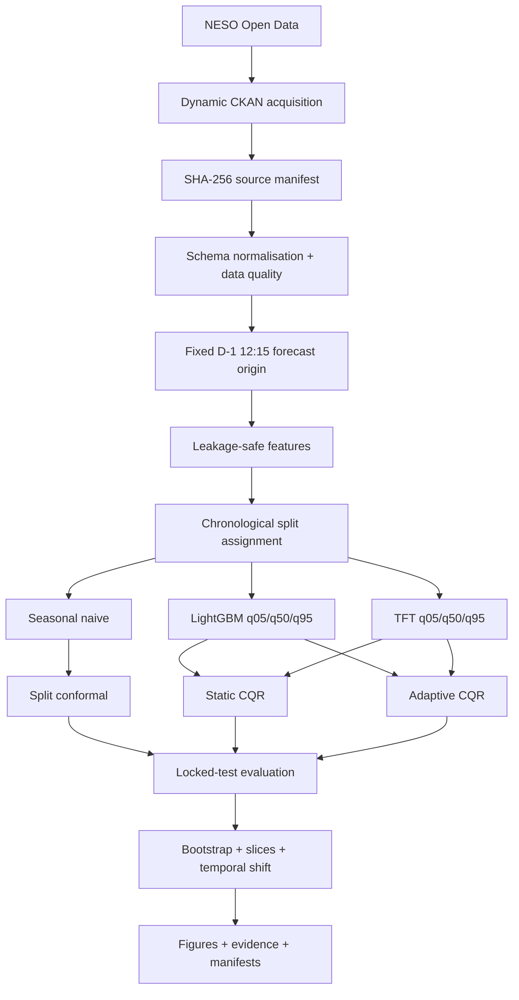

# Architecture

## Design objective

The artefact is designed as a reproducible research pipeline in which data provenance, forecast-origin constraints, model fitting, conformal calibration and evaluation are explicit, separable stages.

## Package boundaries

- `data/`: external resource discovery, downloading, schema normalisation and prepared research table.
- `features/`: point-in-time-safe model matrix construction.
- `models/`: seasonal naive, LightGBM quantile regression and the self-contained TFT.
- `conformal/`: static CQR, adaptive CQR and residual split conformal methods.
- `evaluation/`: point/interval metrics, sensitivity, distribution shift, block bootstrap and interpretability helpers.
- `reporting/`: figures and evidence-pack generation.
- `orchestrator.py`: deterministic stage ordering and output registration.

## Forecast-origin contract

The target is a complete 48-settlement-period day. The information boundary is 12:15 Europe/London on D-1. Any feature that would require an observation later than this origin is masked or replaced with an origin-safe construction.

For the TFT, the encoder ends after settlement period 24 of D-1. The decoder covers the remaining 24 periods of D-1 plus the 48 target periods of D; only the target-day 48 periods are scored.

## Runtime isolation on Apple Silicon

LightGBM and PyTorch may load conflicting native OpenMP/runtime components in the same macOS process. The TFT training stage is therefore executed in an isolated Python subprocess. This preserves the actual TFT implementation while keeping the orchestration process stable.

## Portability

Public manifests store repository-relative paths. Machine-local absolute paths are deliberately excluded from versioned research evidence.
